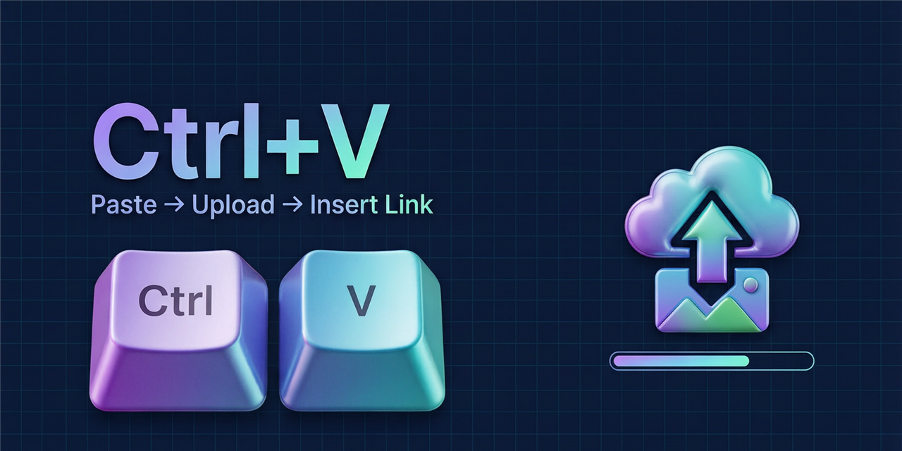

# Ctrl+V Paste-to-ImageHost

[中文](README.md) | **English**

Press <kbd>Ctrl</kbd>+<kbd>V</kbd> on any web page and the screenshot in your clipboard is uploaded to [imgchr.com](https://imgchr.com/) automatically, with the link inserted into the focused input field — no image-host tab, no API key.



## The problem it solves

- **Rich-text editors (where images can be pasted directly)**: the extension does nothing at all — the page's own paste logic runs untouched.
- **Plain `input` / `textarea` fields (text only)**: browsers can only paste a filename there. The extension hands the image to a hidden imgchr page in the background, uploads it, and inserts the link.

## Features

- Paste-to-upload from any page, with 6 output formats: Markdown, direct link, viewer page, HTML, BBCode, and Markdown-with-link (thumbnail).
- Optional timed deletion: delete images after 1 hour / 6 hours / 1 day / 7 days. Prefers the host's own `expiration` field and falls back to a local pending-deletion queue driven by the extension background.
- Built-in quota guard: counts locally against the Terms-of-Service cap (60 uploads/hour) and refuses to send requests once reached.
- Shows the host's content red lines before first use and requires explicit confirmation.
- Results appear as a card with one-click copy buttons for every format.

## How it works

imgchr's free accounts cannot get an API key, so cross-site uploads must be issued by a real imgchr document in its same-origin environment. The extension spins up a hidden offscreen document (containing an invisible imgchr iframe) on demand; that iframe performs the upload and reports back, and the document is destroyed after it goes idle:

```
Ctrl+V on a page ──▶ content.js ──▶ background (service worker)
                                      │ creates on demand
                                      ▼
                             offscreen document ◀── hidden iframe (imgchr.com)
                                      │             same-origin fetch by imgchr-frame.js
                                      ◀── result back ──▶ insert into field / copy to clipboard
```

`auth_token` and login cookies stay inside imgchr's own document at all times — they never leave it and are never replayed.

**What this project deliberately does not do**: scrape the imgchr homepage or extract the one-time `auth_token` to replay it cross-site. That token is CSRF protection; bypassing it would mean breaking a security control, even for uploads to your own account. That is also why the "call the upload endpoint directly" approach is off the table.

## Prerequisite: log in to imgchr

**Register and log in at [imgchr.com](https://imgchr.com/login) before using this extension.**

The upload channel only works while logged in: guest uploads are deleted by the host after 7 days, so the extension refuses to upload while logged out and offers a "log in to imgchr" button. Log in once — the hidden channel reuses the same session afterwards.

## Installation

Requires Chrome 116+ (uses the offscreen documents API).

1. Get this repository (Code ▸ Download ZIP, or `git clone`) and unpack it.
2. Open `chrome://extensions`, enable Developer mode.
3. Click "Load unpacked" and select the unpacked folder (the one containing `manifest.json`).
4. (Optional) In the extension's details page, allow "Access file URLs" and configure the self-reload path described at the top of `background.js` to auto-reload after code changes.

The UI and all messages are localized: Chinese and English are bundled (`_locales/`), selected by your browser's language.

## Usage

1. Confirm the Terms of Service on the extension's options page at first use.
2. Take a screenshot with any tool (as long as the image is in the clipboard), then press <kbd>Ctrl</kbd>+<kbd>V</kbd> in an input field on any page.
3. The link is inserted when the upload finishes; if auto-insert is disabled, it is copied to the clipboard instead.

## Privacy

- This extension collects no data — no analytics, no reporting.
- Images are sent only from your browser to imgchr.com.
- Settings are stored locally in `chrome.storage.local`.

## Quota & content red lines

The most relevant rules from the imgchr.com Terms of Service (rev. 2026-06-05):

- Upload limit: 60 images/hour; 5 MB per image for logged-in users.
- Images containing QR codes are prohibited; cartoons / manga / ACG / anime & game imagery is prohibited; unauthorized movie or TV screenshots and covers are prohibited.
- The free tier is for personal, non-commercial use only.

Violations lead to deletion of all images under the account plus account and IP bans — use your own judgment.

## Layout

```
├── manifest.json      MV3 manifest
├── content.js         page-wide paste listener + result cards
├── background.js      offscreen document lifecycle + job routing + timed deletion
├── offscreen.html/js  hidden channel page (embeds the imgchr iframe)
├── imgchr-frame.js    same-origin upload/deletion inside the imgchr document
├── options.html/css/js settings page
├── _locales/          zh_CN + en messages
└── docs/              cover image
```

## Disclaimer

This is an unofficial third-party tool with no affiliation to imgchr.com, provided as is. Follow the host's Terms of Service; deleted images, account bans or IP bans caused by violations are the user's own responsibility.

## License

[MIT](LICENSE)
